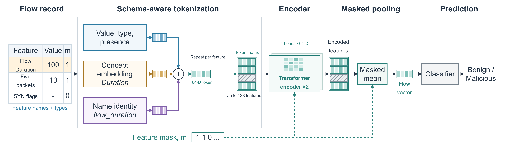
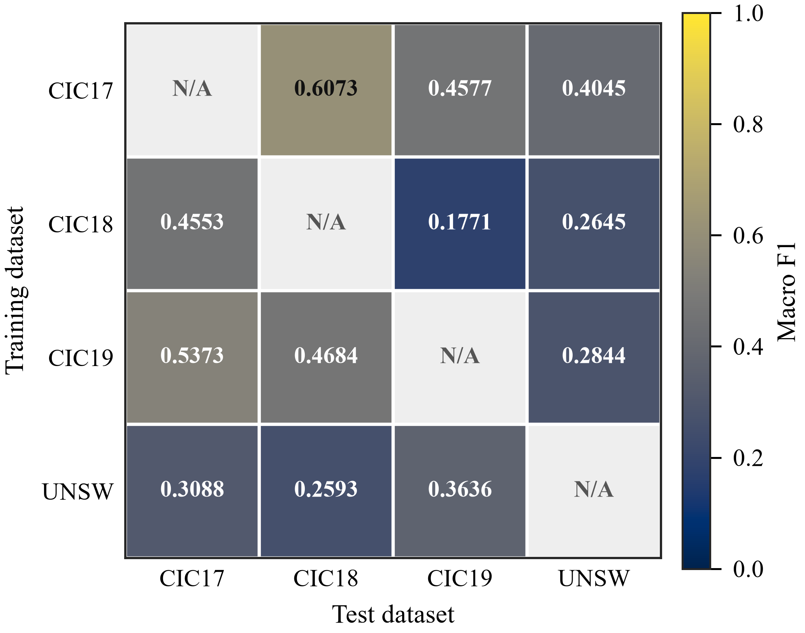

# SchemaNID

**SchemaNID: A Schema-Aware Attention Architecture for Network Intrusion Detection**

SchemaNID is a schema-aware neural architecture for binary, flow-based network
intrusion detection. It represents every available feature as a token that
combines the feature value with its availability, type, broad network concept,
and deterministic name identity. Self-attention models interactions among the
available features, and masked mean pooling creates one representation for the
network flow.

This is the companion repository for the paper. It contains the model,
preprocessing, training loop, evaluation metrics, and ablation switches, plus
the final result tables from the manuscript. The datasets are not included.
It does not contain the baseline models, the Integrated Gradients analysis, or
the full experiment scripts, so the reported numbers cannot be regenerated from
this repository alone.

## Architecture



For each of up to 128 retained features, SchemaNID constructs a 64-dimensional
token from:

1. a fixed signed-log transformation of the value;
2. a presence indicator and numerical/categorical type indicators;
3. one of ten rule-based network-concept identifiers; and
4. a deterministic 16-bit SHA-256 feature-name fingerprint.

Two Transformer encoder layers with four attention heads model relationships
between the feature tokens. The feature-presence mask removes unavailable
positions from both self-attention and mean pooling. Layer normalization and a
small GELU classification head then produce the binary benign/malicious logit.

The code is in four files:

- [`schemanid/model.py`](schemanid/model.py): the architecture and the ablation switches.
- [`schemanid/preprocessing.py`](schemanid/preprocessing.py): fixed value and schema transformations.
- [`schemanid/training.py`](schemanid/training.py): weighted sampling, early stopping, and threshold selection on validation data only.
- [`schemanid/evaluation.py`](schemanid/evaluation.py): prediction and metrics.

## Quick start

Python 3.10, 3.11, or 3.12 is recommended.

```bash
python -m venv .venv
```

Activate the virtual environment:

```powershell
# Windows PowerShell
.venv\Scripts\Activate.ps1
```

```bash
# macOS or Linux
source .venv/bin/activate
```

Then install the dependencies and run the example:

```bash
python -m pip install -r requirements.txt
python example.py
```

`example.py` builds two heterogeneous schemas and performs a forward pass. It
is an architecture check, not a trained intrusion detector.

To run the smoke tests, install `pytest` and run `python -m pytest`.

Minimal use in your own code:

```python
import numpy as np
import torch

from schemanid import SchemaNID, build_registry

schemas = {
    "source": source_feature_names,
    "target": target_feature_names,
}
registry = build_registry(schemas, max_features=128)
values, present = registry.transform(source_dataframe, "source")

model = SchemaNID(registry)
output = model(
    torch.from_numpy(values),
    torch.from_numpy(present),
    torch.from_numpy(np.zeros(len(values), dtype=np.int64)),
)
logits = output["logits"]
```

To train, pass `(values, present, labels, schema_ids)` arrays for the training
and validation sets to `train`. It returns the best model and its threshold:

```python
from schemanid import TrainingConfig, train

result = train(
    SchemaNID(registry),
    (train_values, train_present, train_labels, train_schema_ids),
    (val_values, val_present, val_labels, val_schema_ids),
    TrainingConfig(seed=101),
)
model, threshold = result["model"], result["threshold"]
```

`labels` is a 0/1 array (see `binary_labels`), and `schema_ids` holds the index
of each row's schema in the registry. `predict_probabilities` and
`binary_metrics` in `schemanid/evaluation.py` score a fitted model.

## Datasets

The paper evaluates four public datasets. Download them from their official
providers and follow the license and citation requirements on each page.

| Dataset | Official source | Retained features | Development | Confirmation | Development attack rate |
|---|---|---:|---:|---:|---:|
| CIC-IDS2017 | [University of New Brunswick](https://www.unb.ca/cic/datasets/ids-2017.html) | 78 | 120,000 | 30,000 | 19.62% |
| CSE-CIC-IDS2018 | [University of New Brunswick](https://www.unb.ca/cic/datasets/ids-2018.html) | 82 | 120,000 | 30,000 | 17.14% |
| CICDDoS2019 | [University of New Brunswick](https://www.unb.ca/cic/datasets/ddos-2019.html) | 77 | 120,000 | 30,000 | 77.27% |
| UNSW-NB15 | [UNSW Research](https://research.unsw.edu.au/projects/unsw-nb15-dataset) | 43 | 120,000 | 30,000 | 63.96% |

All original attack categories are mapped to the malicious class (`1`), while
benign or normal traffic is mapped to `0`.

## Preprocessing

The public preprocessing code exposes the core operations used by SchemaNID:

- the caller supplies the feature names to keep. Labels and metadata columns
  must be left out (see the UNSW-NB15 note below);
- at most 128 flow features are retained;
- non-finite values become missing values;
- known protocol strings use fixed numerical codes;
- finite values use
  `clip(sign(x) * log(1 + min(abs(x), 1e30)) / 20, -1, 1)`;
- missing values are represented by zero values with a zero presence mask;
- feature concepts are assigned using fixed name-matching rules, applied in the
  order listed in `CONCEPTS` so that the first matching rule wins;
- normalized feature names become deterministic 16-bit signed fingerprints.

`deterministic_partitions()` in
[`schemanid/preprocessing.py`](schemanid/preprocessing.py) illustrates the
seeded priority sampling and the stratified 80/20 development split. In the
paper's runs, the confirmation records were also chosen to exclude records used
in earlier model-development experiments. The function does not apply that
exclusion, so it does not recreate the paper's exact partitions.

**UNSW-NB15 `id` column.** The reported UNSW-NB15 experiments kept the source
dataset's `id` column, which is why the table above lists 43 features. `id` is a
row identifier, so a model could use it as a shortcut. The paper states this as
a limitation, and the Integrated Gradients analysis removed it. To match the
reported setting, keep `id` in the UNSW-NB15 feature list. To avoid the
shortcut, drop it, which gives 42 features and results that differ from the
table.

**Concept rules.** The name-matching rules are simple, and the first match wins.
As a result, some features fall into broader groups than their names suggest.
For example, IAT, header, and active/idle features of the CIC datasets match
forward volume, backward volume, or packet length first. In CIC-IDS2017 and
CICDDoS2019, `Average Packet Size` matches the TCP flag rule because "ack"
appears inside "packet". The timing, header, and activity concepts are
therefore rarely used. These rules are
part of the reported results and are kept unchanged.

These transformations do not fit target-domain means, variances, quantiles, or
imputation statistics. In source-only cross-domain evaluation, the target
schema is available to construct tokens, but target training records, labels,
and fitted target statistics are not used.

## Experimental protocol

For each dataset, 120,000 records form the development partition and 30,000
separate records form the locked confirmation partition. Deterministic
priority-based reservoir sampling uses seeds 9001, 9002, 9003, and 9004 for
CIC-IDS2017, CSE-CIC-IDS2018, CICDDoS2019, and UNSW-NB15, respectively.

Each development partition is divided into 96,000 training and 24,000
validation records using an 80/20 stratified split with seed 2026. Training and
model selection use only these development records. The confirmation labels
are reserved for final evaluation.

Stable identifiers derived from the dataset, source file, and original row
number were used to verify that the development and confirmation partitions did
not overlap. The experiment manifests stored the partition sizes, identifier
checks, and confirmation-label hashes. Confirmation features and labels were
kept separate until the model and protocol were fixed.

The experiments use three random seeds: **101, 202, and 303**. Each seed
controls model initialization, sampling, and the Python, NumPy, and PyTorch
random generators.

| Setting | Value |
|---|---:|
| Model dimension | 64 |
| Transformer layers | 2 |
| Attention heads | 4 |
| Feed-forward dimension | 192 |
| Dropout | 0.10 |
| Batch size | 256 |
| Optimizer | AdamW |
| Learning rate | 0.0006 |
| Weight decay | 0.0001 |
| Gradient-norm clipping | 5.0 |
| Maximum epochs | 25 |
| Early-stopping patience | 5 epochs |
| Loss | Binary cross-entropy from logits |

Weighted random sampling addresses class imbalance. After every epoch, 181
thresholds from 0.05 to 0.95 are evaluated on validation data. The checkpoint
and threshold with the highest validation Macro F1 are retained. Confirmation
labels never participate in this selection.

## Paper results

The CSV versions of these tables are available in [`results/`](results/). They
contain the final values approved for the manuscript; `example.py` does not
regenerate them.

### In-domain Macro F1

Dataset values are mean ± standard deviation over three seeds. The overall
mean gives equal weight to all four datasets.

| Model | CIC-IDS2017 | CSE-CIC-IDS2018 | CICDDoS2019 | UNSW-NB15 | Overall | Rank |
|---|---:|---:|---:|---:|---:|---:|
| Concept XGBoost | **0.9941 ± 0.0001** | 0.9786 ± 0.0002 | **0.9977 ± 0.0001** | **0.9418 ± 0.0007** | **0.9780** | 1 |
| **SchemaNID** | 0.9940 ± 0.0001 | 0.9770 ± 0.0005 | 0.9970 ± 0.0002 | 0.9400 ± 0.0003 | **0.9770** | 2 |
| Concept Random Forest | 0.9939 ± 0.0001 | 0.9769 ± 0.0006 | 0.9969 ± 0.0000 | 0.9384 ± 0.0003 | 0.9765 | 3 |
| Adapted FlowTransformer | 0.9921 ± 0.0014 | **0.9788 ± 0.0004** | 0.9956 ± 0.0002 | 0.9289 ± 0.0003 | 0.9738 | 4 |
| TreeHive-inspired | 0.9914 ± 0.0019 | 0.9637 ± 0.0053 | 0.9970 ± 0.0004 | 0.8949 ± 0.0033 | 0.9618 | 5 |

SchemaNID ranked second by the overall in-domain mean. The numerical
differences are descriptive and do not establish statistical superiority.

### Source-only cross-domain results

The table averages 12 directed source-to-target pairs and three seeds.

| Model | Macro F1 | Balanced accuracy | MCC |
|---|---:|---:|---:|
| **SchemaNID** | **0.3824** | 0.5044 | 0.0022 |
| Concept Random Forest | 0.3520 | 0.5123 | 0.0454 |
| Concept XGBoost | 0.3506 | **0.5169** | **0.0507** |
| TransTab-style | 0.3287 | 0.4710 | -0.0659 |

SchemaNID achieved the highest mean cross-domain Macro F1, but Concept
XGBoost achieved the highest balanced accuracy and MCC. Cross-domain transfer
therefore remains difficult and direction-dependent for every compared model.



### Cross-domain ablation

| Variant | Macro F1 | Balanced accuracy | MCC |
|---|---:|---:|---:|
| Full SchemaNID | 0.3824 | 0.5044 | 0.0022 |
| Without feature-name vectors | **0.4066** | **0.5442** | **0.1022** |
| Without presence/type metadata | 0.3997 | 0.5291 | 0.0620 |
| Without concept embeddings | 0.3731 | 0.4801 | -0.0468 |

Removing feature-name vectors produced the strongest numerical result in this
ablation. Removing concept embeddings reduced all three metrics. These are
numerical findings rather than demonstrated causal or statistically
significant effects.

## Repository structure

```text
SchemaNID/
├── assets/                 # Architecture and paper-result figures
├── results/                # Final manuscript result tables
├── schemanid/
│   ├── model.py            # Schema-aware attention architecture
│   ├── preprocessing.py    # Values, masks, concepts, names, and types
│   ├── training.py         # Paper training and selection procedure
│   └── evaluation.py       # Prediction and metrics
├── example.py              # Small architecture example
├── tests/                  # Smoke tests (python -m pytest)
├── requirements.txt
├── CITATION.cff
└── LICENSE
```

## Scope and limitations

- The task is binary detection; attack families are not predicted separately.
- The study uses four public datasets and three random seeds.
- The name fingerprint represents stable identity, not linguistic meaning.
- The FlowTransformer, TreeHive, and TransTab results come from adapted,
  inspired, or style-matched implementations, not exact reproductions of the
  original methods.
- The rule-based concepts are deliberately simple.
- Threshold policies differ between some comparators, so comparisons are
  reported descriptively.

## Citation

Please cite the associated paper (2026 IEEE International Conference on
Communication, Networks and Satellite, COMNETSAT) and this repository.
Citation metadata is in [`CITATION.cff`](CITATION.cff).

## License

The code is released under the [MIT License](LICENSE). Dataset licenses remain
with their respective providers.
